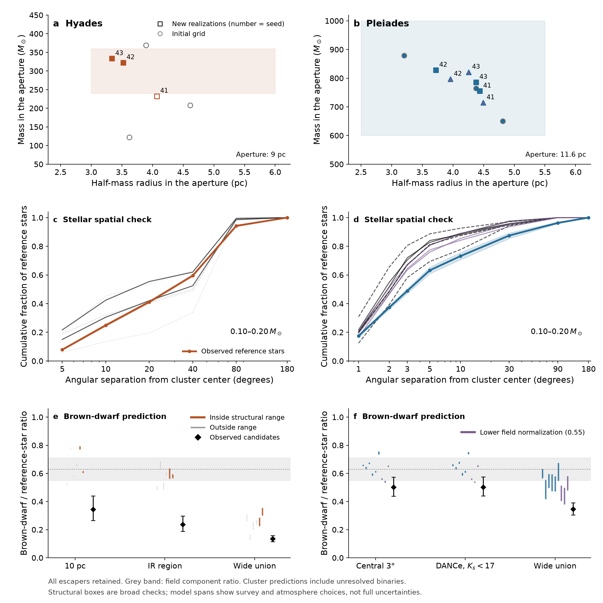
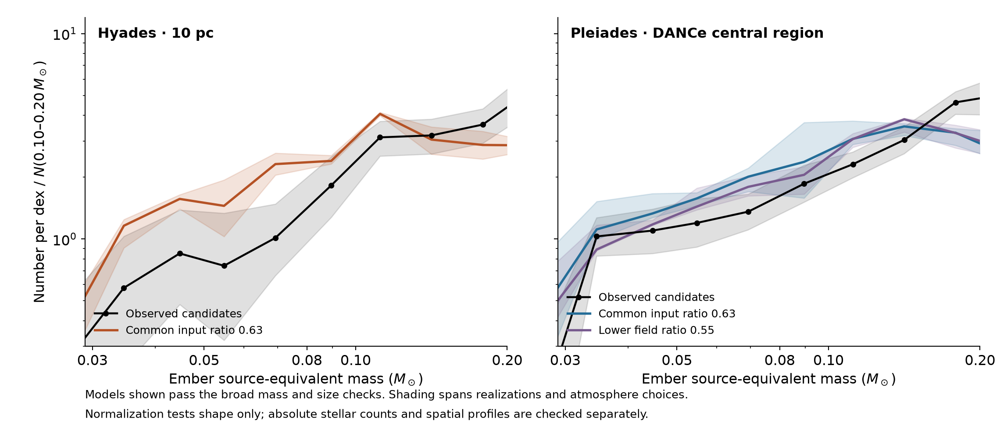

# Cluster dissolution and the low-mass population

**Unequal survey reach contributes to the apparent brown-dwarf deficit. The
17 completed simulations do not establish that dissolution and incompleteness
explain the entire difference, or that the clusters formed different mass functions.**
The [membership-selection analysis](membership-selection.md) identifies further
selection effects that are absent from these synthetic catalogues.

All associated members and tidal-tail candidates remain the scientific target.
Smaller apertures below are diagnostic comparisons, not a redefinition of the
population. No escaper is deleted from the simulations.

The panels compare fixed-aperture cluster mass and size, reference-star spatial
distributions, and brown-dwarf/reference-star ratios. Boxes are broad structural
checks, not confidence regions. Each model span varies the stated atmosphere
and survey choices; it is not a completeness posterior. Grey shading shows the
field component-ratio sensitivity; simulated catalogues blend unresolved pairs.
Random-pairing stress tests are preserved in the tables but omitted from the plot.

## The observational comparison

Define R = N(0.03–0.08 solar masses)/N(0.10–0.20 solar masses). These are fixed
comparison intervals, not classifications of hydrogen burning for every object.
The counts use the existing Ember luminosity-to-mass inference, including its
age and atmosphere choices. Intervals add approximate counting uncertainty;
they do not include unknown contamination, completeness or binary distributions.

| Sample | Brown dwarfs | Reference stars | R | Approximate 68% interval |
|---|---:|---:|---:|---:|
| Hyades, all associated candidates | 47 | 361 | 0.1303 | 0.1105–0.1538 |
| Hyades, within 10 pc | 24 | 68 | 0.3433 | 0.2657–0.4398 |
| Hyades, matched infrared region | 25 | 107 | 0.2376 | 0.1878–0.2972 |
| Pleiades, all associated candidates | 199 | 590 | 0.3426 | 0.2996–0.3857 |
| Pleiades, central DANCe sample | 136 | 274.5 | 0.5019 | 0.4398–0.5748 |

The DANCe comparison uses membership probability above 0.84, angular separation
below 3 degrees, and Ks < 17. This probability-only cut is slightly stricter than
the paper's membership-plus-uncertainty candidate definition. Its published
classifier tests give 90% recovery and 4.3% contamination at that threshold.
Their factor 0.9404 is used only as an absolute-count sensitivity; assuming it
acts equally on both mass intervals leaves R unchanged. It is not a calibration
of brown-dwarf recovery in unobserved tails.
[Olivares et al. 2018](https://arxiv.org/abs/1804.08360),
[Bouy et al. 2015](https://arxiv.org/abs/1502.03728).

Missing Hyades J/K photometry was filled using exact Gaia identifiers and the
Gaia–2MASS crossmatch. Missing values no longer silently fail the brightness cut.
Bolometric luminosities and masses were unchanged. The additional measurements
also improve the empirical infrared magnitude–luminosity relation used to observe
the simulations. Photometry coverage and query checksums are saved separately.
The Hyades infrared region uses the published sky bounds, an 18-pc radius and
J < 17.5; its heterogeneous member list is not a complete infrared census.
[Schneider et al. 2022](https://arxiv.org/abs/2203.11090),
[Schneider et al. 2024](https://arxiv.org/abs/2408.10112).

## What the simulations establish

The simulations use the same unsoftened PeTar dynamics, stellar mass loss,
Galactic potential and similar-mass binary prescription as the
[first calculation](dynamics-methods.md). Each starts with
3000 components. Seeds 41–43 vary the initial realization. Initial half-mass
radii are 2.5 pc for the Hyades and 3 pc for the principal Pleiades ensemble.
Three additional Pleiades calculations at 4 pc use R = 0.55, the lower end of
the independently obtained field sensitivity range; this is not a fitted birth
ratio, nor a corresponding Hyades test. The realized birth ratios fluctuate
around their expected values and are recorded individually.
The field inference and its assumptions are described in the
[field comparison](field-mass-function.md).

| Cluster | Initial half-mass radius (pc) | Seed | Expected birth R | Final aperture mass (solar masses) | Final half-mass radius (pc) |
|---|---:|---:|---:|---:|---:|
| Hyades | 2.5 | 41 | 0.63 | 232.5 | 4.069 |
| Hyades | 2.5 | 42 | 0.63 | 322.4 | 3.521 |
| Hyades | 2.5 | 43 | 0.63 | 333.3 | 3.336 |
| Pleiades | 3 | 41 | 0.63 | 755.1 | 4.437 |
| Pleiades | 3 | 42 | 0.63 | 828 | 3.72 |
| Pleiades | 3 | 43 | 0.63 | 785.6 | 4.375 |
| Pleiades | 4 | 41 | 0.55 | 714.3 | 4.491 |
| Pleiades | 4 | 42 | 0.55 | 796.4 | 3.958 |
| Pleiades | 4 | 43 | 0.55 | 820.9 | 4.255 |

Mass and half-mass radius refer to the same fixed aperture: 9 pc for the Hyades,
11.6 pc for the Pleiades. White dwarfs are included; black holes and neutron stars
are excluded. Broad mass ranges of 240–360 and 600–1000 solar masses, respectively,
were specified before examining the new endpoints. A model just outside a box
is not physically ruled out. Definitions and literature mass estimates differ.
[Hyades census](https://arxiv.org/abs/1105.6093),
[Pleiades mass estimates](https://academic.oup.com/mnras/article/525/2/2315/7233111).

**Pleiades:** structurally plausible models predict central DANCe ratios
0.5889–0.7481 for expected birth R = 0.63 and 0.5368–0.6538
for R = 0.55. The latter approach the observed 0.5019, but their reference-star
counts remain too large in the center. After the aggregate classifier factor,
they predict 317–359 reference stars versus about 275 observed. Other models
can come closer in absolute counts while missing the brown-dwarf ratio. The
wide reference-star distribution also extends farther than most simulations.
There is no satisfactory joint fit yet.

**Hyades:** a new realization has 333.3 solar masses inside 9 pc and half-mass
radius 3.336 pc, satisfying the broad structural check. Yet it predicts a wide
catalogue ratio of 0.3049–0.3514, versus 0.1346 observed within 200 pc. It also
contains too few wide reference stars while overpredicting their central count.
That cannot be repaired simply by declaring additional missed observed stars.
Across all completed structurally screened Hyades models the wide ratio range
is 0.2288–0.3514. The realization with 232.5 solar masses is close to, but below,
the broad mass range. The stochastic structural spread matters.

**Multiplicity:** using the published DANCe near-equal-binary probabilities and
two assumed component flux ratios raises the central component estimate from
about 0.50–0.52 to 0.53–0.55. This is a modest effect. It does not recover unseen
low-mass companions or tails, and the component-corrected result must not be
compared directly with a model whose binaries remain blended.

The second figure checks distribution shape after normalizing to reference
stars. Absolute counts are checked separately above. Its upper plotted mass
is 0.20 solar masses to avoid interpreting the synthetic-light grid's 0.25-solar-mass
edge as a physical fall in the mass function. Model shading spans the completed
realizations and atmosphere choices, not a fitted probability interval.
The stellar distribution shapes also disagree: fitting the integrated reference
count alone would overlook this. The imposed stellar birth-mass slope has not
been inferred from these clusters.

A direct magnitude-count check includes DANCe candidates even when they lack
an assigned luminosity or mass. In the central sample, 13 of 334 candidates
with 13.5 <= Ks < 17 lack luminosities. Including them leaves a model excess in
most magnitude bins. For example, the lower-field models predict 67–75 sources
at Ks = 14.5–15 after the classifier adjustment, against 42 observed. The
disagreement therefore is not just loss of these unconverted candidates.
The empirical conversion from model luminosity to magnitude remains an
assumption. Counts and the full missing-luminosity list are saved.

## What remains decisive

The all-associated Pleiades sample need not be the debris of one bound cluster.
The Greater Pleiades Complex includes multiple coeval groups over about 600 pc
whose common origin is a giant molecular cloud. A single initially virialized
Plummer cluster is consequently a restricted hypothesis for that entire union.
[Boyle, Bouma & Mann 2025](https://arxiv.org/abs/2511.07533).

The next useful calculation is a joint fit to stellar counts and spatial
distributions with a calibrated survey selection, allowing an extended birth
population, gas loss and initial mass segregation where required. The brown-dwarf
counts should then test that fit. Unconstrained extra N-body runs or freely fitted
completeness factors would not resolve the ambiguity. Current results make an
intrinsic birth-mass-function claim premature.

## Validation and reproduction

All included endpoints reach 650 Myr or 125 Myr. Unique initial/surviving IDs,
total mass, and the agreement of spatial and mass-bin counts were checked.
The Hyades seed-43 continuation used a doubled global tree step after 200 Myr;
a 100–105 Myr control changed half-mass radius by 1.370e-6 fractionally, with
unchanged aperture number ratios. Binary grouping, unsoftened forces and close
encounter treatment were retained. This short test is not a proof of identical
long-term chaotic trajectories.

Completed simulations consumed 8.931 CPU-hours in total;
the new completed subset consumed 4.35. These totals
include discarded work before saved-state continuations, exclude installation
and short probes, and include every planned full-age run.
They are CPU time, not elapsed campaign time.

Workspace: `out/cluster-dissolution-oct9-v2/`. Its README contains execution order.
`cluster_followup.sqlite` stores structural outcomes, counts, initial components,
final descendants and cost. `validation_receipt.json` identifies pending runs and
hashes every included endpoint. `joint_checks.csv`, `normalized_mass_shapes.csv`,
`dance_binary_sensitivity.csv` and the full draw tables preserve the comparisons.
No shared Ember source or stellar table was changed.

See the [research index](../README.md) for the combined interpretation and
[reproduction guide](../REPRODUCING.md) for published and locally retained data.
