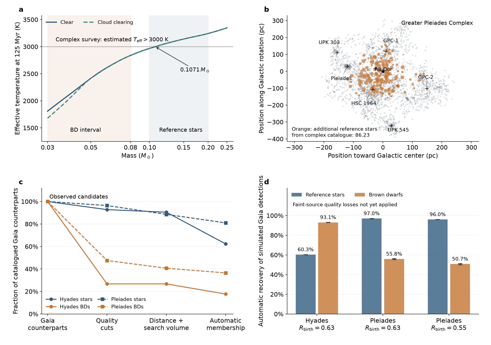

# Membership selection in the cluster mass-function comparison

**The earlier uniform membership-recovery factors are too optimistic for faint
objects.** Actual catalogue cuts reject many known brown-dwarf candidates while
retaining most reference stars. The extended Pleiades catalogue also selects
warmer stars and provides essentially no direct brown-dwarf census. All associated
and tidal-tail candidates remain in our data and scientific target.

Panel **a** maps the Greater Pleiades Complex temperature requirement onto Ember's
125 Myr isochrones. Panel **b** shows its published spatial distribution; orange
marks candidates found only in that catalogue, weighted by the probability of
falling in our reference-mass interval. Crosses mark published group centers;
the star marks the Sun. Panel **c** follows actual candidates with catalogued Gaia
counterparts through successive requirements. Panel **d** injects three existing
cluster models into the observed Gaia background. Its bars exclude the faint-source
quality losses illustrated in panel c; they cannot be read as final completeness
corrections. Small error bars span the two atmosphere choices, not confidence limits.

Here “BD” means the fixed comparison interval 0.03–0.08 solar masses, and reference
stars span 0.10–0.20 solar masses. Counts are source counts after unresolved-binary
blending, with fractional observed counts averaged over Ember mass-inference draws.
They assume candidate membership, rather than correcting contamination.

## What the observed candidates show

We retrieved Gaia DR3 attributes for all 5415 catalogued counterparts in the
luminosity-usable candidate sample. The quality requirement combines RUWE < 1.4
with astrometric excess noise < 1 mas or its significance < 2, following the
published search. [Risbud, Jadhav & Kroupa 2025](https://arxiv.org/abs/2501.17225).

| Candidates | All retained | Gaia counterparts | After quality cuts | After automatic membership |
|---|---:|---:|---:|---:|
| Hyades reference stars | 361.4 | 361.4 | 335.4 | 225.2 |
| Hyades BDs | 47.02 | 26.08 | 6.977 | 4.617 |
| Pleiades reference stars | 594.8 | 560.1 | 540.1 | 453.6 |
| Pleiades BDs | 201.0 | 67.77 | 32.21 | 24.73 |

Quality cuts alone retain **26.75%** of the Hyades BD counterparts and **47.53%**
of the Pleiades BD counterparts, compared with **92.79%** and **96.43%** of the
reference stars. This demonstrates a substantial differential selection effect.
It does not measure completeness against the unknown true population: these
candidates were themselves found by heterogeneous, incomplete searches. Missing
catalogued counterparts also need not mean that Gaia detected no source there.

The automatic membership reconstruction recovers 2028 of 2029 published Pleiades
members and 922 of 975 Hyades members selected by the comparable convergent-point
method. The Hyades search's additional velocity-trend correction is excluded.
Manual removal of unrelated overdensities is not reproduced. Consequently the
automatic candidate counts above differ slightly from the published catalogue's
228.7 Hyades and 437.5 Pleiades reference stars; the BD counts agree.

## Why the distant Pleiades population needs separate survey treatment

The Greater Pleiades Complex search requires estimated effective temperatures
above 3000 K and TESS magnitudes brighter than 16. Its published sample therefore
cannot supply a uniform BD census across the complex.
[Boyle, Bouma & Mann 2025](https://arxiv.org/abs/2511.07533).

In the nominal Ember isochrones the temperature cutoff lies near **0.1071 solar
masses**; even the warm end of our BD interval is about **2838 K**. Estimated
temperatures can scatter across the cut. Illustrative Gaussian errors of 100 and
200 K admit roughly 0.32% and 3.1% of a population uniform in log mass over our BD
interval; these are assumed error scenarios, not measured catalogue completeness.

This catalogue contributes **86.23 reference-star candidates** found in none of
our other selected lists. Its 1.242 expected BD assignments are inconsistent with
the nominal temperature eligibility: 1.180 come from candidates flagged as
inconsistent with the cluster color–magnitude sequence. They are retained and
flagged, rather than silently treated as a meaningful BD census.

Including these additional candidates changes the raw Pleiades BD/reference ratio
from 0.3927 to 0.3379. This is a source-attribution diagnostic, not a reason to
exclude associated stars. A formation analysis must describe the individual
groups and their differing survey coverage. Our nearest-center partition is
descriptive and is **not** the authors' group membership assignment.

## Simulated-member recovery

We reused three completed collisional models chosen from the previous stellar
comparison, without fitting their BD counts. There were 288 injection trials:
three endpoints, two atmosphere choices, with/without astrometric noise, and
24 realizations. The field contains actual Gaia sources; all known candidate
members are removed before inserting the simulated cluster.

| Model | Automatic recovery of Gaia-detected stars | Automatic recovery of Gaia-detected BDs |
|---|---:|---:|
| Hyades, birth R = 0.63 | 60.28–60.32% | 92.98–93.15% |
| Pleiades, birth R = 0.63 | 96.94–97.03% | 55.28–56.39% |
| Pleiades, birth R = 0.55 | 96.03–96.07% | 50.11–51.39% |

R is the birth **component** ratio in the same mass intervals. Gaia's detection
function preferentially retains nearby Hyades BDs; many detectable reference
stars extend into sparse, dispersed tails. Pleiades BDs face much larger distance
errors at their greater distance. Detection and membership recovery therefore
cannot be represented by one mass-independent multiplier.

The conditional simulations still predict too many BDs: 48.00–53.29 in the Hyades,
107.4–109.0 in the R = 0.63 Pleiades model, and 94.21–95.71 in its R = 0.55
alternative, against 4.617 and 24.73 in the comparable published Gaia catalogue.
These predictions omit the severe quality losses measured above, so this is not
yet evidence for different birth mass functions. Reference-star predictions are
231.6–233.9, 468.4–469.6 and 482.2–485.7, respectively. No population normalization
was adjusted in this experiment.

The mock calculation includes sky-dependent Gaia detection, empirical G-band
photometry, unresolved pairs, distance errors, search geometry and local neighbor
counts. Errors are magnitude-dependent medians from quality-selected field sources,
with independent Gaussian perturbations. It does not yet model rejected astrometric
solutions, binary effects on Gaia quality, manual population isolation, or the
infrared surveys' complete selection. Bright neighbors use the cluster evolution
model's luminosities with an approximate G conversion. Thus this is a conditional
recovery experiment, not an end-to-end reproduction of every catalogue.
[Gaia detection model](https://arxiv.org/abs/2208.09335).

The next joint inference needs a faint-source quality model and the infrared
selection, plus a population description tied to the associated groups. Simply
multiplying by the candidate retention fractions above would mistake a selected
sample for an independent completeness calibration. These findings qualify the
uniform-recovery assumptions in the [previous stellar test](stellar-fit.md).

## Reproduction

Workspace: `out/cluster-membership-oct9-v1/`. Its README gives the command order;
`cluster_membership_test.sqlite` contains candidate flags, source attribution,
group partition, published-member recovery and every injection count. Raw Gaia
queries and download checksums are retained. Exact integer source IDs, count
ordering, source-union accounting, neighborhood geometry and database integrity
were checked. The injection loops took 60.52 seconds of measured wall time,
excluding imports, catalogue retrieval and plotting. No new collisional or Ember
calculations were needed; all 17 earlier cluster models remain complete.

See the [research index](../README.md) for the combined interpretation and
[reproduction guide](../REPRODUCING.md) for published and locally retained data.
