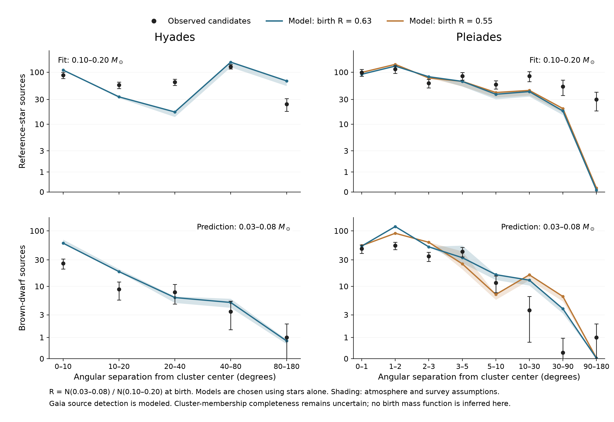

# Can the same models account for the stars and brown dwarfs?

**Selection update:** the [membership audit](membership-selection.md)
finds substantial mass-dependent astrometric-quality losses and a stellar
temperature cutoff in the Greater Pleiades Complex catalogue. The uniform
recovery scenarios below are sensitivity assumptions, not a calibrated selection
model. Their brown-dwarf excess must not be interpreted as a birth-IMF measurement.

**The restricted model family still fails the joint test.** Its best stellar
descriptions predict too many brown dwarfs, while also missing the observed
stellar spatial distribution. A smooth, diffuse associated population does not
repair both discrepancies. This does not establish different birth mass functions:
membership selection and the initial spatial structure remain insufficiently known.

Points show candidate-source counts inferred with Ember. Error bars combine
mass-inference variance with Poisson counting variance, showing an approximate
one-standard-deviation range clipped at zero; they
exclude unknown contamination and completeness. Curves show models chosen using
only the 0.10–0.20-solar-mass stars, with no adjustment to their brown-dwarf birth
ratio. Lines join angular bins for readability. The vertical scale is approximately
logarithmic above one source and linear close to zero. Shading spans the declared
atmosphere and survey scenarios, not a confidence interval. The 0.55 birth-ratio
alternative was simulated only for the Pleiades.

| Population | Birth R | Observed stars | Predicted stars | Observed brown dwarfs | Predicted brown dwarfs |
|---|---:|---:|---:|---:|---:|
| Hyades | 0.63 | 361.4 | 335.4–385.9 | 47.02 | 88.04–102.8 |
| Pleiades | 0.55 | 583.9 | 457.3–490.8 | 195.7 | 251.5–281.7 |
| Pleiades | 0.63 | 583.9 | 437.3–469.6 | 195.7 | 277.5–314.5 |

R denotes N(0.03–0.08 solar masses)/N(0.10–0.20 solar masses), fixed comparison
intervals rather than a hydrogen-burning classification. Birth R counts components;
the observed and predicted counts above count sources after unresolved-binary
blending. Fractional counts are means over mass-inference draws. They can differ
slightly from medians in other summaries. The field-motivated birth ratios are
specified independently of these cluster counts; see the
[field analysis](field-mass-function.md).

The Hyades model has about 110 reference stars within 10 degrees, compared with
87.54 candidates, but only 17.22 between 20 and 40 degrees, compared with 64.43.
Adding a positive diffuse population cannot fix every angular range at once.
The selected diffuse amplitude is zero in all eight survey/atmosphere scenarios.
The best Pleiades models add only 7.539–16.34 initial reference stars in the
diffuse population and continue to miss the extended stellar distribution.
Their covariance-weighted score improves by less than one; these scores are
diagnostics, not calibrated likelihoods or significance levels.

Removing cross-bin covariance from the fitting objective changes which Pleiades
realization is preferred and increases the diffuse amplitude. It still predicts
248.9–317.1 brown-dwarf sources against 195.7 observed, and does not recover the
angular pattern. The Hyades choice is unchanged. The conclusion therefore does
not depend on selecting one particular covariance weighting.

The distant Pleiades candidates illustrate why a single dissolving cluster is
too limited a starting description: essentially all candidates beyond 90 degrees
come from the Greater Pleiades Complex catalogue. These contribute 29.81 expected
reference stars. Of the 53.08 between 30 and 90 degrees, 52.05 appear in that
catalogue. Source lists overlap and these contributions must not be added across
catalogues. The published complex contains multiple coeval groups, plausibly
formed in one molecular cloud, rather than requiring every member to have escaped
one compact cluster. [Boyle, Bouma & Mann 2025](https://arxiv.org/abs/2511.07533).

## What is modeled

All 17 collisional simulations have reached their requested ages: 650 Myr for
the Hyades and 125 Myr for the Pleiades. The two random-pairing stress tests are
excluded from inference; 15 endpoints supply the bound-cluster alternatives.
Every simulated escaper remains available. Each existing cluster keeps its actual
population normalization. Broad final mass/size ranges screen candidates; these
are orientation ranges, not formal observational error bars. Dropping that screen
does not change the preferred models for the illustrated scenario.

The diffuse alternatives start at the cluster's Galactic birth location, with
one-axis Gaussian sizes of 10, 30 or 60 pc and one-axis speeds of 0.3, 0.7 or
1.5 km/s. Their trajectories are integrated through MWPotential2014 without
linearizing the Galactic force. The 27 combinations reuse existing mass and
binary draws; they are templates per initial reference star, not 27 additional
collisional clusters. This approximates an initially unbound association. It
does not simulate gas expulsion, primordial mass segregation or multiple distinct
birth centers.

Diffuse self-gravity and the bound cluster's force are omitted. Allowed amplitudes
must keep their estimated initial potential energy below 20% of kinetic energy.
Selected cases are below 2.200%, and their added mass in the central structural
aperture is below 0.009927 solar masses even using an initial-mass upper bound.
This check does not guarantee negligible deflection for every individual tracer.
A tighter orbit integration changes test positions by less than 0.000004831 pc.

Gaia detection now uses the published sky-dependent DR3 completeness function,
evaluated at each simulated source's location and magnitude. The original
order-7 M10 map, Zenodo record 8063930, is retained with its verified checksum.
This replaces a sharp Gaia magnitude cutoff, but supplies **source detection,
not recovery by a cluster-membership algorithm**.
[Cantat-Gaudin et al. 2023](https://arxiv.org/abs/2208.09335),
[GaiaUnlimited documentation](https://gaiaunlimited.readthedocs.io/en/latest/notebooks/dr3-empirical-completeness.html).

Gaia membership-recovery factors of 0.8 and 1 are sensitivity choices, not measured
completeness. Infrared selection uses the stated survey footprints and limiting
magnitudes, with a shallow/deep alternative. Its detailed color and proper-motion
selection is not reproduced. Within 3 degrees of the Pleiades, the comparison
uses DANCe candidates with probability above 0.84 and Ks < 17, and its published
aggregate recovery/contamination adjustment. Outside 3 degrees, all associated
and tail candidates are retained. The full candidate union remains in the data;
the matched central selection removes 10.87 expected reference stars and 5.258
expected brown dwarfs from this particular comparison.
[Olivares et al. 2018](https://arxiv.org/abs/1804.08360).

Ember supplies the existing cluster-composition isochrones and clear/cloud-clearing
alternatives. Mass inference retains nonmonotonic branches. The photometric
calibration, age, initial-state, reddening, and binary limitations remain those
documented in the [cluster mass-function analysis](cluster-mass-functions.md).
No new stellar tracks or changes to Ember physics were required.

## What this says about the apparent deficit

Survey reach remains an important part of the contrast, but the present models
do not explain the full data. Their brown-dwarf excess cannot yet be converted
into an intrinsic birth deficit because their stellar comparison already fails.
The next discriminating calculation is to measure recovery of simulated members
by the actual membership selections, and to represent the observed associated
groups rather than fitting a single smooth halo. More random seeds of the same
initial model would not resolve either limitation.

## Reproduction and data

The 17 collisional calculations used 8.931 CPU-hours in total, including the
saved-state continuation accounting. They were reused here. The 27 diffuse orbit
integrations took 80.44 seconds of measured wall time in total; this excludes
catalogue fitting and plotting and is not the cost of a new collisional ensemble.
No cluster jobs remain running.

Workspace: `out/cluster-stellar-fit-oct9-v1/`; reproduction order and dependencies
are in its `README.md`. `cluster_stellar_test.sqlite` contains the fit candidates,
frozen stellar choices, held-out predictions, angular/mass profiles, source
attribution and independent objective check. `plan.json`, map/source checksums,
orbit checks, and `validation_receipt.json` record the assumptions and checks.
The compact result tables are in [tables/stellar-fit](../tables/stellar-fit).

See the [research index](../README.md) for the combined interpretation and
[reproduction guide](../REPRODUCING.md) for published and locally retained data.
