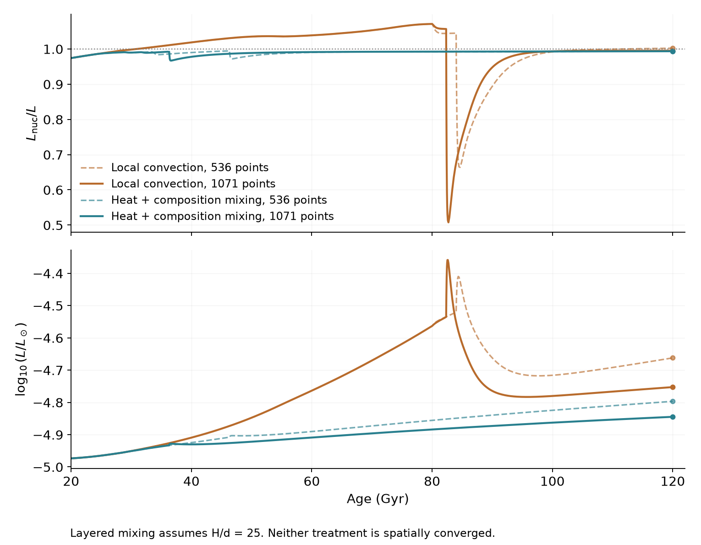

# Hydrogen burning near the stellar boundary

Ember compares clear and cloudy atmospheres at five initial metal abundances,
from one third to three times Z_ref = 0.01648, with Y = 0.27. The cloudy case
uses f_sed = 2 and clears between 900 and 1200 K. All tracks begin on Hayashi
contraction with deuterium.

Bars span tested cooling and burning masses. Cooling requires nuclear support
below 0.1%; sustained burning requires 99–101% support at 1 Tyr, varying by
less than 2 percentage points over the final 50 Gyr. These are finite-age
numerical brackets, not statistical confidence intervals. Hollow diamonds
are unfinished trials. Interval ends now use matched EOS and envelope settings.
At three times Z_ref, fresh controls confirm the 0.0580–0.0585-solar-mass cloudy
interval. At one third Z_ref, the cloudy interval narrows to 0.0695–0.0705.
Physical uncertainties are additional.

The 22 masses use Z = 0.04945. Filled endpoints reach 1 Tyr or the fading
cutoff; open endpoints are unfinished. The 0.05835-solar-mass continuation reaches 897 Gyr and 825.4 K,
with nuclear support below 0.1%. Four warmer originals reach 486.7–500 Gyr
using documented atmosphere and interior-table extensions. The opacity and
H/He boundary responses retain stated approximations. These completions
do not validate the earlier mixing events or tighten the mass bracket.
Lines connect saved models; no tail is drawn beyond a computed endpoint.

## Mixing and the sharp features

At 0.05825 solar masses, the largest saved nuclear-to-surface luminosity
ratios are 1.027 without semiconvection, 1.009 with weak composition mixing,
and 1.021 with coupled heat/composition transport. Both mixing sensitivities
reach 1 Tyr. The coupled model assumes layer height H/d = 25 and marginal
transport between mixing regimes; that prescription remains uncertain.

Convective-region mergers produce sharp excursions that do not converge
numerically. Shorter steps change one dip from 0.8320 to 0.8044; changing
only the solver prediction history moves it and deepens it to 0.6639.

Fresh 0.05820-solar-mass tracks on 536 and 1071 points agree in luminosity
within 0.043% before the merger and both reach 107.1% nuclear support.
The subsequent minima are 0.6639 and 0.5077. At 120 Gyr, luminosities still
differ by 18.82%. Mixing leaves composition steps whose spacing roughly
halves with the mesh. The detailed excursions and later trajectories
remain uncertain; conservation alone does not validate them.

Coupled heat/composition mixing removes the broad peak and sharp dip on
both grids, but leaves a 10.48% luminosity difference at 120 Gyr. It forms
mixed blocks separated by thin composition jumps whose positions still
depend on the grid. Nearly all the mass can be in convective regions
without those regions being connected. This smoother alternative is also
not spatially converged.

The nearby-metallicity tests hold mass at 0.05815 solar masses and helium
fixed. Their endpoints have unequal ages. The 3.03-Z_ref case includes a
small atmosphere continuation beyond the native grid.

A conductive layer can support a composition gradient and undergo
oscillatory mixing: [Mirouh et al.](https://arxiv.org/abs/1112.4819),
[Moll et al.](https://arxiv.org/abs/1506.07900).
The [interior diagram](Ember_boundary_interior.png) shows the calculation
without semiconvection. The separate 0.058-solar-mass upturn disappears
with shorter timesteps: [comparison](timestep_comparison.png).

Atmospheric H/He response, cloud clearing, transport and the additive
ideal-metal EOS limit physical accuracy. Fine mass spacing does not remove
these uncertainties.

## Reproduce the figures

Run `python plot.py`, `python plot_transition_mass.py`,
`python plot_mixing_metallicity.py`, `python plot_interior.py` and
`python plot_mesh_comparison.py` with NumPy
and Matplotlib. CSV/NPZ files retain plotted states; JSON records source
fingerprints, endpoints, assumptions and numerical checks. These reproduce
figures, not stellar runs; full physics tables and checkpoints are separate.
