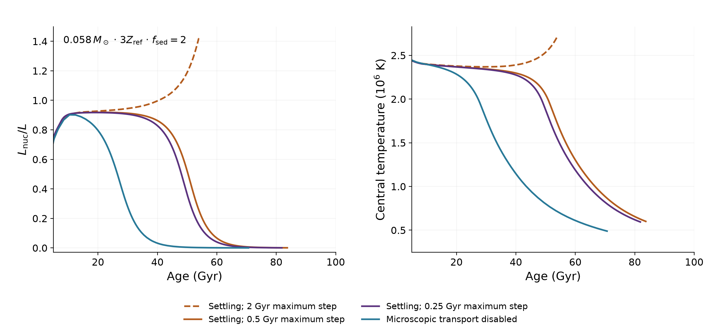

# Hydrogen burning near the stellar boundary

These preliminary Ember calculations follow objects near the hydrogen-burning
limit at three times the reference metal abundance: Z=0.04945, Y=0.27.
The cloudy atmosphere uses f_sed=2, with a prescribed transition to clear
atmospheres between 900 and 1200 K.

The upper panel contains 13 masses; eight reach 1 Tyr. Open circles mark
incomplete calculations. All accepted states are shown, with straight lines
between them. The lower panel compares independent 50-Myr-step calculations
with the coarser early evolution. Those short runs are not joined to older
tails. Steps are smaller for the displayed 0.058 and 0.05825 tracks
(250 Myr maximum), and for 0.0585 (500 Myr); the other full curves allow
2 Gyr. The continuing survey follows burning objects to at least 1 Tyr,
rather than ending when nuclear power first approaches surface luminosity.

## What the checks establish

- The original 0.058-solar-mass upturn changes qualitatively with timestep.
  Smaller steps lead to fading, so the larger-step upturn is not a reliable
  physical result. The time of fading is still sensitive to the step size.
- Around the 0.057-solar-mass nuclear maximum, matched 100-, 50- and 25-Myr
  steps give peak ratios of 0.7197, 0.7198 and 0.7198 at about 6.6 Gyr.
  These controls share the same 5-Gyr starting model; they test the maximum,
  not accumulated error in the earlier evolution.
- The 0.05825-solar-mass overshoot survives a timestep reduction: maxima
  are 1.022 and 1.027 with 500- and 250-Myr steps. Nuclear power may exceed
  emitted luminosity while the object expands. Near 129 Gyr, the 1.877%
  excess agrees with the change in internal plus gravitational energy. A
  calculation resolving more of the envelope also retains an energy-balanced
  excess. These checks use the same physical inputs as the evolution; the
  detailed amplitude, timing and atmosphere dependence remain under test.

Fine mass spacing is not a measurement of the physical boundary's uncertainty.
Atmospheric H/He changes, high-metallicity cloud physics and the additive
metal EOS remain important limitations. The EOS includes ideal neutral metals
in the H/He mixture; this is not a validated partial-ionization treatment at
large interior metal abundance. Atmospheric H/He coverage and the approximation
used for the outer envelope stop several tracks before 1 Tyr.

The atmosphere tables also affect the shoulders near 2 Gyr: nuclear power is
smooth while surface cooling changes slope. The Diamondback authors caution
that some cloudy-grid irregularities are numerical, so individual bends
cannot yet be assigned to specific opacity species.
[Morley et al. 2024](https://arxiv.org/html/2402.00758v1).

## Data

`tracks.csv`, `early.csv` and `timestep_comparison.csv` contain the plotted
states. `provenance.json` records endpoints and input fingerprints;
`numerical_checks.json` records the peak and energy checks. The local
development tables and full stellar checkpoints are not included; these
files reproduce the figures, not a complete stellar calculation.

Run `python plot.py` with NumPy and Matplotlib installed to regenerate both
PNGs. Machine-readable data retain full precision.
