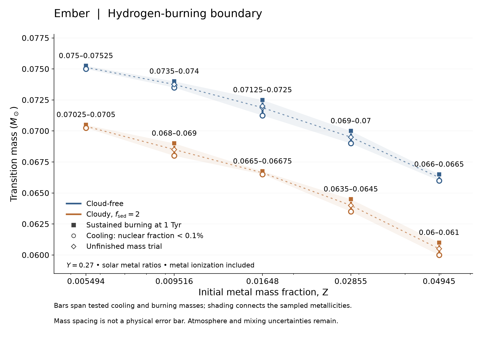
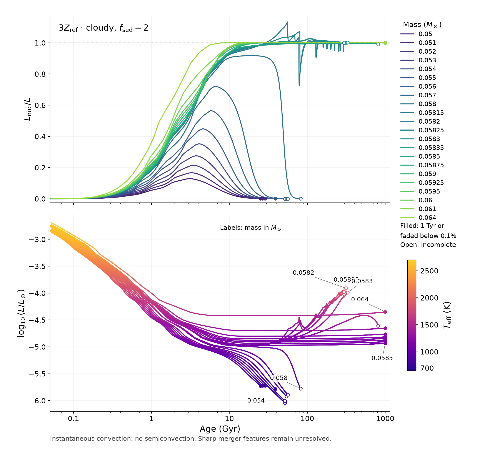
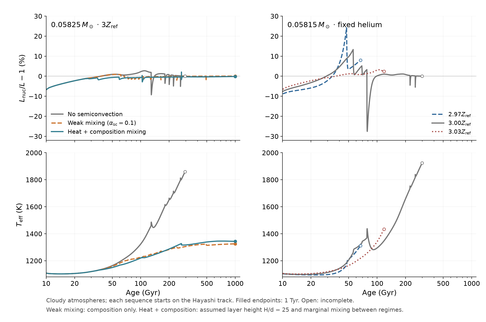

# Hydrogen burning near the stellar boundary

Ember compares clear and cloudy atmospheres at five initial metal abundances,
from one third to three times Z_ref = 0.01648, with Y = 0.27. The cloudy case
uses f_sed = 2 and clears between 900 and 1200 K. All tracks begin on Hayashi
contraction with deuterium.

Bars span tested cooling and burning masses. Cooling requires nuclear support
below 0.1%; sustained burning requires 99–101% support at 1 Tyr, varying by
less than 2 percentage points over the final 50 Gyr. These are finite-age
numerical brackets, not statistical confidence intervals. Hollow diamonds
are unfinished trials. Asterisks flag pairs with different EOS coverage or
envelope resolution; matched controls are pending. Physical uncertainties
are additional.

The 22 masses use Z = 0.04945. Filled endpoints reach 1 Tyr or the fading
cutoff; open endpoints are unfinished. Five surge tracks end at atmosphere
composition limits. Three have advanced to 294.3–311.6 Gyr after a change
to the solver's starting guess, with physical equations unchanged. Lines
connect saved models; there are no smoothed or extrapolated tails.

## Mixing and the sharp features

At 0.05825 solar masses, the largest saved nuclear-to-surface luminosity
ratios are 1.027 without semiconvection, 1.009 with weak composition mixing,
and 1.021 with coupled heat/composition transport. Both mixing sensitivities
reach 1 Tyr. The coupled model assumes layer height H/d = 25 and marginal
transport between mixing regimes; that prescription remains uncertain.

Convective-region mergers produce sharp excursions. A smaller-timestep
0.05820 calculation retains the dip and recovery, but its minimum ratio
changes from 0.8320 to 0.8044. At the common 82.99-Gyr endpoint, luminosity
differs by 1.392% and temperature by 3.036 K. One additional cell mixes;
alternating single-cell stable layers remain unresolved. These checks
support a thermal response within the model, not a converged physical surge.

The nearby-metallicity tests hold mass at 0.05815 solar masses and helium
fixed. Their endpoints have unequal ages. The 3.03-Z_ref case includes a
small atmosphere continuation beyond the native grid.

A conductive layer can support a composition gradient and undergo
oscillatory mixing: [Mirouh et al.](https://arxiv.org/abs/1112.4819),
[Moll et al.](https://arxiv.org/abs/1506.07900).
The [interior diagram](Ember_boundary_interior.png) shows the calculation
without semiconvection. The separate 0.058-solar-mass upturn disappears
with shorter timesteps: [comparison](timestep_comparison.png).

Atmospheric H/He response, cloud clearing, transport and the additive
ideal-metal EOS limit physical accuracy. Fine mass spacing does not remove
these uncertainties.

## Reproduce the figures

Run `python plot.py`, `python plot_transition_mass.py`,
`python plot_mixing_metallicity.py` and `python plot_interior.py` with NumPy
and Matplotlib. CSV/NPZ files retain plotted states; JSON records source
fingerprints, endpoints, assumptions and numerical checks. These reproduce
figures, not stellar runs; full physics tables and checkpoints are separate.
