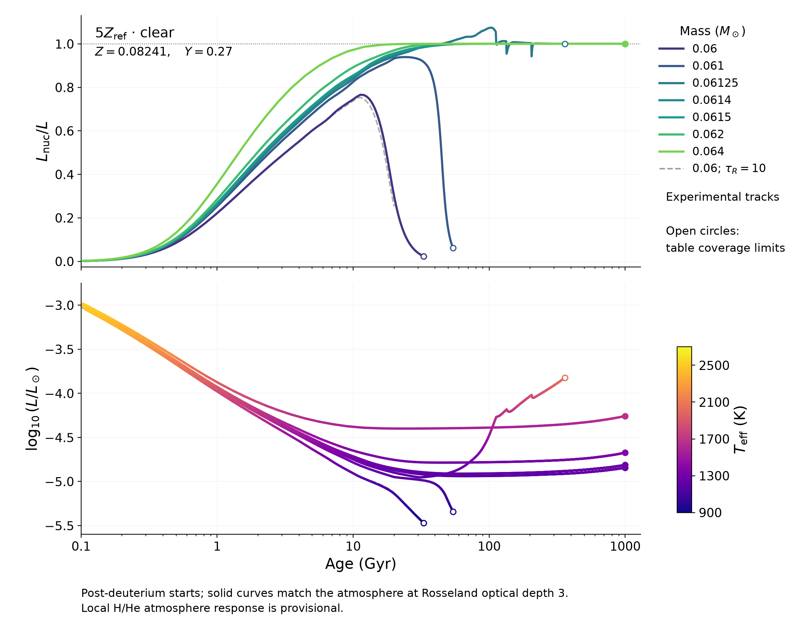

# Clear atmospheres at five times reference metallicity

These experimental tracks use initial Z = 0.08241, Y = 0.27, solar metal
ratios, and an EOS that includes metal ionization. They start after deuterium
burning. They do not yet establish the hydrogen-burning boundary.

| Mass (solar masses) | Age (Gyr) | Temperature (K) | Nuclear fraction | Endpoint |
|---|---:|---:|---:|---|
| 0.06 | 33.00 | 913.5 | 0.02339 | Atmosphere H/He coverage |
| 0.061 | 54.23 | 978.8 | 0.06170 | Atmosphere H/He coverage |
| 0.06125 | 359.8 | 2042 | 1.000 | Atmosphere composition coverage |
| 0.0614 | 1000 | 1254 | 1.001 | 1 Tyr |
| 0.0615 | 1000 | 1274 | 1 | 1 Tyr |
| 0.062 | 1000 | 1368 | 1.001 | 1 Tyr |
| 0.064 | 1000 | 1671 | 1 | 1 Tyr |

Open circles mark table-coverage limits. Nuclear balance at 1 Tyr does not
establish permanent burning.

## Behavior and checks

The 0.06-solar-mass model peaks at 76.61% nuclear support, develops a conductive
interior, and cools. The dashed optical-depth-10 comparison also cools, with
a 75.41% peak. At 20 Gyr, changing the matching depth from 3 to 10 changes
luminosity by 2.023% and temperature by 0.8544%.

The 0.06125-solar-mass model peaks at 107.4% nuclear support at 103.8 Gyr,
then approaches balance while warming and expanding. At 359.8 Gyr, a
conductive layer separates convective regions over m/M = 0.3577–0.3830;
a second, one-cell interval lies at 0.3984–0.4035. Conduction supplies
95.73–97.26% of the main layer's radiative-plus-conductive transport.
Only 1.932% of the initial total hydrogen has burned, while central X has
fallen by 28.66%, mostly through redistribution. Central Z reaches 0.1962.
Neither eventual cooling nor permanent burning has been established.

A fivefold shorter maximum timestep retains the peak and separating layer.
The detailed mixing adjustment near 112.6 Gyr remains timestep sensitive;
the two calculations differ by 0.2903% in luminosity at 118 Gyr. Fresh
short-step controls at 536, 1072 and 2144 points retain separation, with
percent-level luminosity differences. Added slow mixing also retains layers
through 150 Gyr but can strongly change luminosity. See the
[conductive-layer tests](../CONDUCTIVE_BAND_TESTS.md) for the comparisons and
physical limitations.

Reducing conductivity by 10% keeps the 0.06125-solar-mass model fully
convective through 1 Tyr, at 1222 K with nuclear fraction 1.001. Increasing
it by 10% gives earlier separation and declining nuclear support before
the atmosphere limit. These are sensitivity tests, not error bars.
The 0.0614- and 0.064-solar-mass controls remain fully convective through
1 Tyr. The unresolved 0.0611-solar-mass trial is excluded from the figure.

## Atmospheres and remaining uncertainty

The preweighted Sonora clear columns pass flux and stability checks and use
corrected layer gravity. Their composition and dry adiabatic gradient are
prescribed. Surface-composition changes use a bounded local H/He response.

That response was calibrated with an error in the native gas-opacity mixer:
it omitted the fraction of particles represented by the absorbing gases.
The preweighted source columns use a different calculation. Corrected native
pairs at 913, 1184 and 1657 K now pass their checks; a corrected family covering
formation and subsequent evolution is not yet assembled. Its absolute
pressure differences are large enough to affect the burning boundary.
The plotted tracks therefore retain a provisional atmosphere response.

The extended EOS preserves the repaired lower-metallicity source planes and
passes checks on the saved star and enriched hot-core conditions. Radiative
opacity coverage is verified through source Z = 0.239. These checks do not
validate arbitrary high-metallicity birth compositions or cooler atmospheres.

`plot.py` reproduces the figure from `tracks.csv`; `provenance.json` records
the inputs, continuation checks and computing time. Curves are not smoothed.
